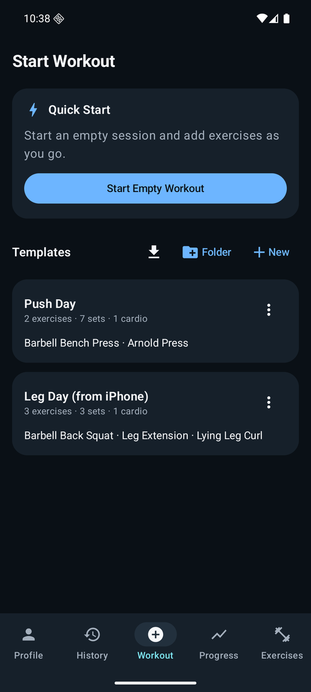
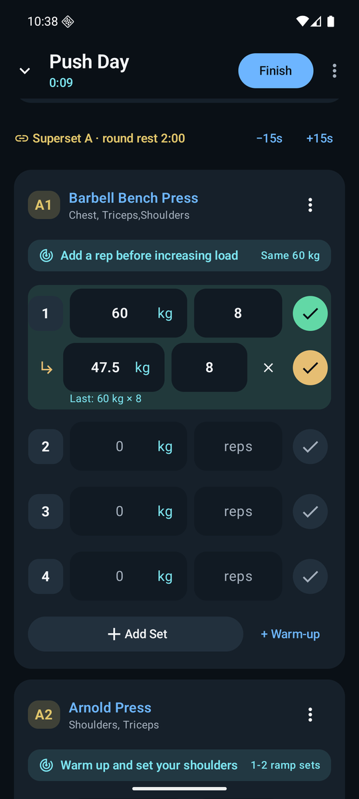
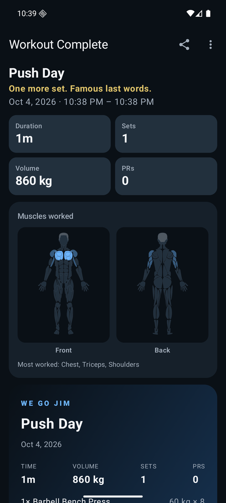
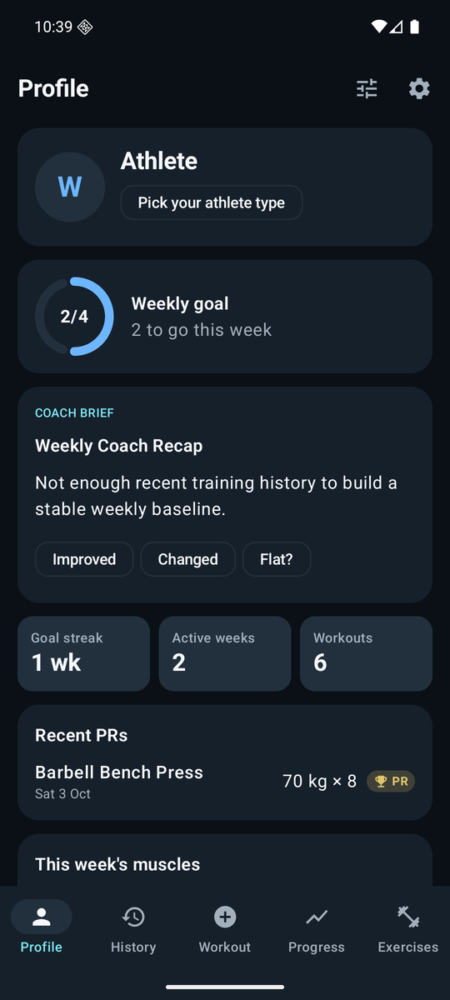
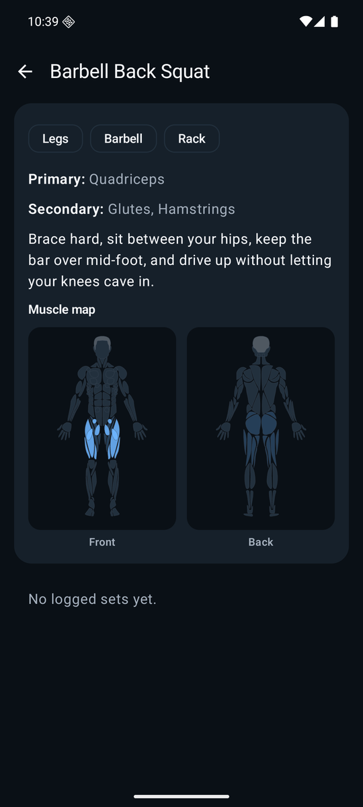
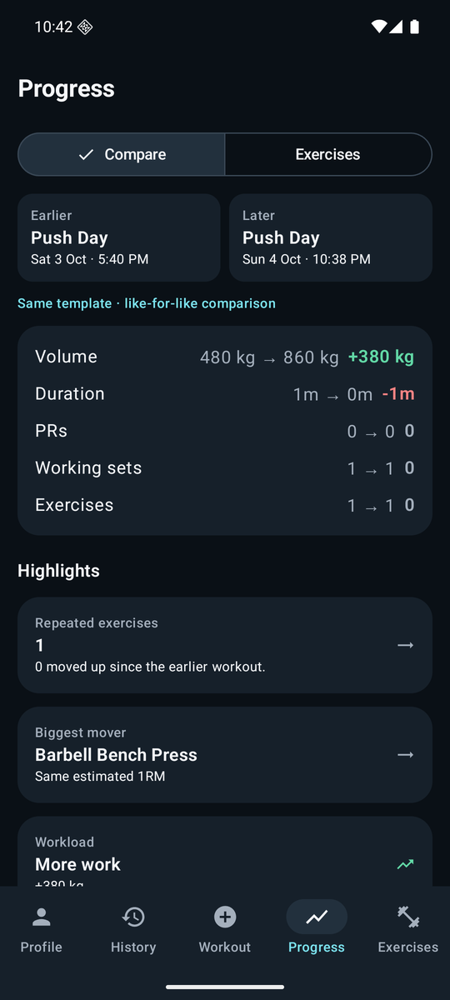

# We Go Jim for Android

An Android port of **[We Go Jim](https://github.com/Hortlund/we-go-jim)**, the opinionated, local-first
workout tracker for iPhone by Andreas Hortlund. It follows the same training loop: plan a workout, log it
without friction, finish cleanly, and see what changed. It is written from scratch in Kotlin with
Jetpack Compose and keeps the iOS app's behaviour, formulas and template file format.

<p align="center">
  
  
  
</p>
<p align="center">
  
  
  
</p>

## Features

- **Plan reusable workouts.** Templates in folders with warm-up and working sets, rep ranges, loads,
  rest timers, dropsets, two-exercise supersets, rotating alternative exercises and cardio blocks.
- **Log without losing context.** Start empty or from a template, see last session's numbers with
  *Fill Last*, get training guidance (warm-ups, rep targets, when to change the load), and run rest timers
  that notify on time in the background. Supersets rest after the second exercise.
- **Cardio alongside strength.** Warm-up, main and finisher blocks with time, distance or open goals,
  live timers with goal alerts, and pace, speed or rowing split.
- **Resume reliably.** The active workout is kept in memory and snapshotted to disk, so it survives
  minimising, backgrounding and the app being killed.
- **Finish cleanly.** Summary with PRs (estimated 1RM), volume, estimated calories, the muscles you worked,
  a shareable card image, and an optional diff to apply today's changes back to the template.
- **Interactive muscle map.** Front and back body on every exercise, tap a muscle to filter the
  catalog, and weekly and per-workout heatmaps drawn on the body.
- **History and progress.** List and calendar views, edit or delete past workouts, save any workout as a
  template, compare two workouts, and chart per-exercise trends for 1RM, max weight, volume and reps.
- **Profile dashboard.** Configurable cards for weekly goal, coach brief, streaks, PRs, muscle heatmap,
  consistency calendar, top exercises, exercise trends and calories, plus an avatar, 39 athlete types and
  six themes (with a December-only one).
- **Your data stays yours.** Everything lives on the device in a Room database, is included in Android's
  device backup, and can be saved to or restored from a backup file. Optional Health Connect export and a
  weekly-goal home screen widget.
- **Share templates with iPhone users.** `.wgjtemplate` files are wire-compatible with the iOS app
  (format version 8, single templates and folders). Open one from any app to import it.

A bundled catalog of 247 exercises, the same one the iOS app ships, works offline, and you can add
your own.

## Install

Requires Android 8.0 (API 26) or newer.

1. Download the latest APK from the [Releases page](https://github.com/GenericD00d/we-go-jim-droid/releases/latest).
2. Open it on your phone. Android will ask you to allow installs from your browser or file manager.
3. Tap **Install**.

Releases are signed with a development key and meant for sideloading. An APK you build yourself is
signed with your own debug key and can't install over a release (or the reverse) without an uninstall
first. Save a backup file from **Settings → Save backup file** before switching.

## Build

Requires JDK 17 and the Android SDK (compileSdk 36).

```sh
./gradlew assembleRelease        # sideloadable APK
./gradlew assembleDebug          # debug APK
./gradlew testDebugUnitTest      # JVM tests for the ported logic
```

## How it maps to the iOS app

| iOS | Android |
| --- | --- |
| SwiftUI, SwiftData | Jetpack Compose, Room |
| CloudKit private backup | Android Auto Backup + backup file export/restore |
| Apple Health export | Health Connect export (opt-in) |
| WidgetKit weekly goal widget | Glance home screen widget |
| On-device Foundation Models coach copy | The iOS deterministic coach recap (same rules) |
| MuscleMap Swift package | Same artwork, generated into Kotlin by `scripts/gen_body_paths.py` |
| Exercise images fetched from an online catalog | Not included; the bundled catalog has no images |

Not ported (added to the iOS app after this port was made): GPS routes, Live Activities, outdoor
cycling, and the training journey and yearly recaps. iOS-only items such as App Store review prompts
are out of scope.

## Architecture

The rule from the original carries over: keep screens thin. Anything that decides how data is saved,
restored, projected or summarised lives in `data/`.

- `data/` holds the Room entities and DAOs and the `Repository`. It also holds:
  - `ActiveWorkoutStore`: memory-first, snapshotted to `active_workout.json`.
  - `WorkoutEditor` and `WorkoutEditing`: structure edits shared by the live workout and history editing.
  - Ports of the iOS services:
    - `PerformanceMath`: Epley e1RM and unit normalisation.
    - `Analytics`: workout comparison, muscle heatmap, calorie estimator, trends, streaks and the weekly coach.
    - `TrainingGuidance`.
    - `Transfer`: `.wgjtemplate` files and backups.
- `ui/` holds the Compose screens. `ui/body/` is the muscle map renderer and the region mapping.
- `RestTimerAlarm`, `WeeklyGoalWidget` and `HealthConnectExport` are the platform integrations.

## Credits and license

- **We Go Jim** for iOS by Andreas Hortlund, MIT License (`LICENSE-original-WGJ`). This port reuses its
  exercise catalog, formulas, copy and template format.
- **MuscleMap** by Melih Colpan, MIT License (`licenses/MuscleMap-LICENSE`), for the body map artwork.

"We Go Jim" is the original app's name. If you publish this port, check with the original author or
rename it.
